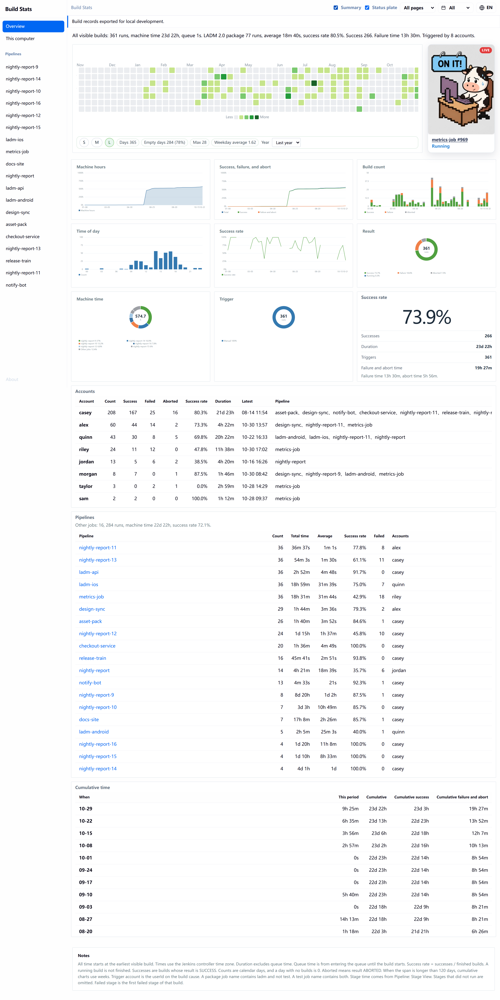
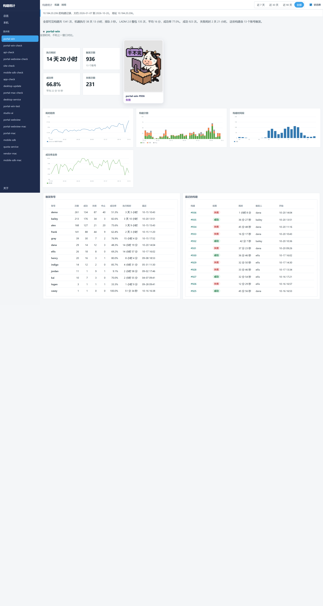
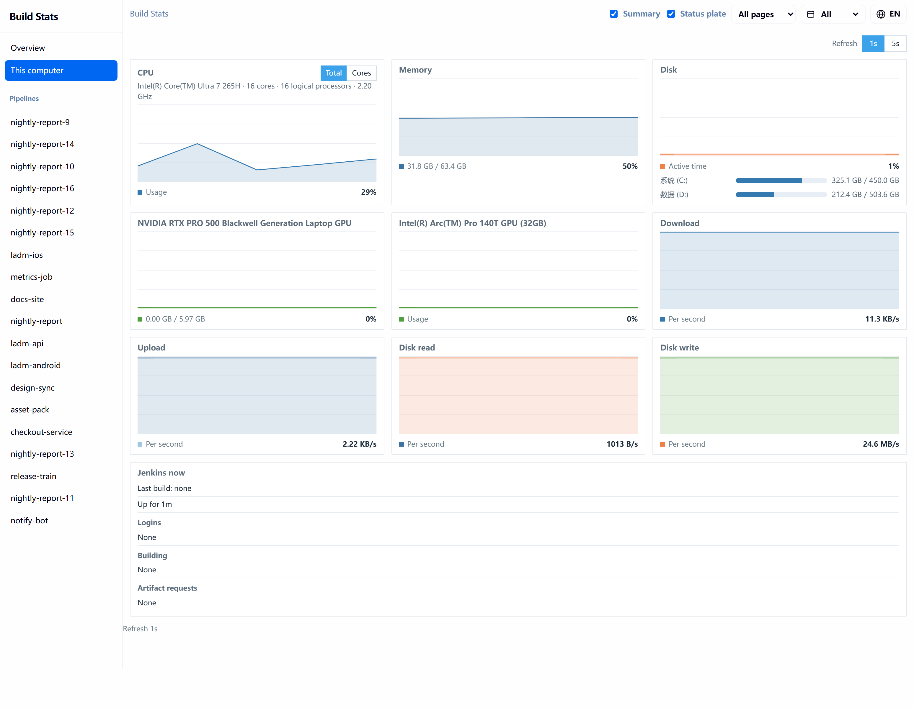
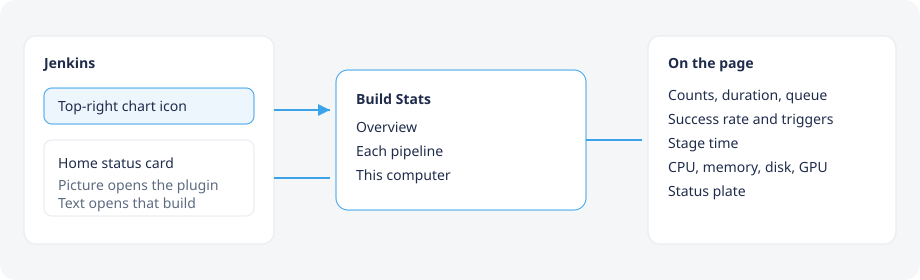

# Build Stats

<p align="center">
  <a href="https://build-stats-plugin.xmuli.tech/"></a>
  <a href="https://github.com/XMuli/build-stats-plugin"></a>
  <a href="https://www.jenkins.io/"></a>
  <a href="https://adoptium.net/"></a>
  <a href="LICENSE"></a>
</p>

<p align="center">
  <a href="https://build-stats-plugin.xmuli.tech/"><strong>Website</strong></a>
  &nbsp;&nbsp;·&nbsp;&nbsp;
  <a href="https://github.com/XMuli/build-stats-plugin"><strong>GitHub</strong></a>
  &nbsp;&nbsp;·&nbsp;&nbsp;
  <a href="README.zh-CN.md"><strong>中文说明</strong></a>
</p>

Build Stats turns the builds you can see into one page: counts, duration, queue time, success rate, who triggered them, and pipeline stage time. It also shows this computer's CPU, memory, disk, GPU, and network.

Requires Jenkins 2.555.3 or newer, and Java 21 on the controller. After install, open `/build-stats`.

## Screenshots

### Overview

<p align="center">
  <a href="https://build-stats-plugin.xmuli.tech/#overview">
    
  </a>
</p>

Heatmap, cumulative machine time, success and failure, build count, time of day, success rate, result, machine time, trigger, and trigger account. Numbers come from builds visible to the signed-in user. [Open this section on the website](https://build-stats-plugin.xmuli.tech/#overview).

### One pipeline

<p align="center">
  <a href="https://build-stats-plugin.xmuli.tech/#pipeline">
    
  </a>
</p>

Each pipeline has its own page. Stage duration is included when Pipeline: Stage View data exists. [Open this section on the website](https://build-stats-plugin.xmuli.tech/#pipeline).

### This computer

<p align="center">
  <a href="https://build-stats-plugin.xmuli.tech/#machine">
    
  </a>
</p>

The machine running Jenkins: CPU, memory, disk, GPU, network, and disk throughput. [Open this section on the website](https://build-stats-plugin.xmuli.tech/#machine).

### Status plates

The overview and each pipeline carry this plate. It follows the newest build in the current range.

<table>
  <tr>
    <td align="center" width="25%"><br><strong>ON IT!</strong><br>Running</td>
    <td align="center" width="25%"><br><strong>ALL DONE!</strong><br>Success</td>
    <td align="center" width="25%"><br><strong>NEVER-ENDING WORK</strong><br>Failure or unstable</td>
    <td align="center" width="25%"><br><strong>I QUIT!</strong><br>Aborted or not built</td>
  </tr>
</table>

[See the plates on the website](https://build-stats-plugin.xmuli.tech/#plates).

## How to open it

After install, the chart icon at the top right of Jenkins opens the plugin. On the Jenkins home page, the status card sits at the bottom right. Drag it, dock it to the right edge, or close it. The picture opens Build Stats. The text under the picture opens that build.

<p align="center">
  
</p>

<p align="center">
  
</p>

The page address is `/build-stats`.

The page follows the Jenkins language. On About, Language can be set to 中文 or English. That choice stays in this browser and overrides Jenkins until you change it again.

## About

The author and GitHub link are fixed. A replacement logo stays in this browser only. **Restore default** clears it.

| Field | Default |
| --- | --- |
| Author | XMuli |
| Website | https://build-stats-plugin.xmuli.tech/ |
| GitHub | https://github.com/XMuli/build-stats-plugin |
| Logo | `src/main/webapp/images/logo.jpg` |

Replace `logo.jpg` to change the image every new browser sees.

## Build

JDK 21.

```
mvn package
```

The package is `target/build-stats.hpi`. Until the plugin is hosted by the Jenkins project, install that file from **Manage Jenkins → Plugins → Advanced settings → Deploy Plugin**.

## Publish to the Jenkins update center

Listing on [plugins.jenkins.io](https://plugins.jenkins.io) happens only after the Jenkins hosting team forks this repository into `jenkinsci`. Releases then go out through `.github/workflows/cd.yaml` when ci.jenkins.io reports a passing build. Version numbers look like `123.vabcdef`, not `1.0.0`.

The steps are in the [plugin hosting guide](https://www.jenkins.io/doc/developer/publishing/requesting-hosting/). Open a hosting request in [repository-permissions-updater](https://github.com/jenkins-infra/repository-permissions-updater/issues/new/choose) for `build-stats-plugin`.

A tag on this repository can still attach an `.hpi` to a GitHub Release for a manual install. That release is not the Jenkins update center.
